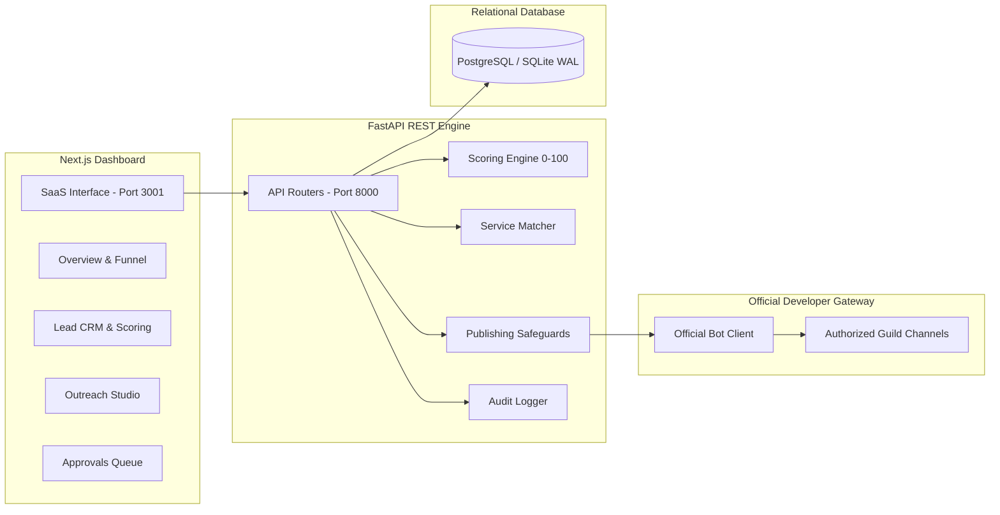

# APK HUNTER GRID
### Discord Prospect Intelligence & Community Discovery Platform

APK Hunter Grid is a dedicated B2B prospecting, community intelligence, lead scoring, and authorized outreach management system engineered for streaming platforms, IPTV operators, and streaming application developers.

---

## 🎯 Target Service Domains
1. **IPTV Subscription Services** — High-availability multi-screen channels, VOD & EPG.
2. **Reseller Panel Solutions** — Scalable multi-tier management, credit top-up APIs & automated provisioning.
3. **Authorized Restream Services** — Redundant datacenter origin feeds & high-bandwidth media relays.
4. **Streaming App Rebranding** — White-label Android TV, Fire TV, and Mobile APKs (custom DNS hardcodes, splash screens, themes).
5. **Custom App Development** — Native ExoPlayer, Flutter, and React Native OTT streaming applications.

---

## 🛡️ Anti-Spam Compliance & Safety Guardrails
APK Hunter Grid adheres to platform integrity principles:
- **Zero Self-Bot / Zero Mass-DM**: No personal token automation, no user scraping, no bulk unsolicited direct messages.
- **Official Bot Architecture**: All interactions occur via Discord's official Bot Developer Gateway with least-privilege permissions (`542128`: Send Messages, View Channel, Embed Links).
- **Mandatory Human-in-the-Loop Approval**: Outbound promotional messages cannot be dispatched without:
  1. Official bot invited and authorized in the guild.
  2. Destination channel explicitly approved for commercial posting (`is_promotional_approved == True`).
  3. Server rules verified to allow advertising.
  4. Operator signed approval record in the database.
- **Anti-Duplicate Pacing**: Built-in 7-day cooldown prevention for repetitive server dispatches.

---

## 🌐 Live System URLs
- **Web Dashboard UI**: [http://localhost:3001](http://localhost:3001)
- **FastAPI REST Backend**: [http://localhost:8000](http://localhost:8000)
- **Interactive OpenAPI Documentation**: [http://localhost:8000/docs](http://localhost:8000/docs)
- **Health Check Endpoint**: [http://localhost:8000/health](http://localhost:8000/health)

---

## 🏗️ Architecture Overview



---

## 🚀 Quickstart Local Run

### 1. Backend Setup
```bash
# Activate virtual environment
.\.venv\Scripts\Activate.ps1

# Start FastAPI server
$env:PYTHONPATH="backend"
python -m uvicorn app.main:app --host 0.0.0.0 --port 8000
```

### 2. Frontend Setup
```bash
cd frontend
npm install
npm run dev
# Dashboard opens on http://localhost:3001
```

### 3. Run Automated Tests
```bash
$env:PYTHONPATH="backend"
pytest tests -v
```

---

## 🔑 Default Credentials
- **Operator Email**: `admin@apkhunter.grid`
- **Operator Password**: `HunterGrid2026!`
